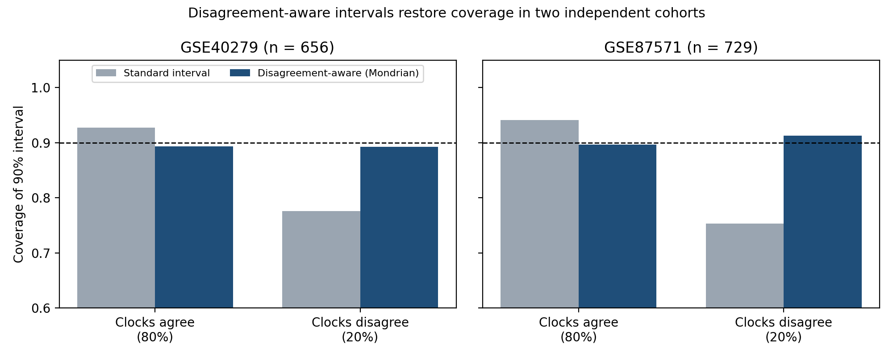

# When can we trust an ageing clock?

A small pilot on public DNA methylation data asking a simple question:
**different epigenetic clocks give different ages for the same person — does that disagreement tell us when an estimate should not be trusted?**

## Data
- **GSE40279** (Hannum et al., 2013): Illumina 450k methylation, whole blood, **656 people**, ages 19–101
- Clocks run with [biolearn](https://github.com/bio-learn/biolearn): Horvath v1, Hannum, PhenoAge, Horvath v2, Lin, Zhang (10 CpG)

## What I did
1. Ran six published clocks on the same people.
2. Converted each clock to standardised **age acceleration** (residual on chronological age), so clocks are comparable.
3. Defined a per-person **disagreement score** = spread of age acceleration across the six clocks.
4. Built **split-conformal** 90% prediction intervals for one clock (Horvath v1), repeated over 20 random calibration/test splits.
5. Compared a **standard** interval (same width for everyone) with a **disagreement-aware** interval (width scaled by the disagreement score).

## Results
- Clocks agree only partly: correlations of age acceleration between clocks range from **0.16 to 0.63**.
- Disagreement is similar for women and men and across the two ethnic groups, but **rises with age** (median 0.56 under 40 vs 0.74 over 80).
- Where clocks disagree, the clock is more wrong: median error **6.1 vs 3.8 years** (top 20% disagreement vs the rest).

| 90% interval | Coverage, low disagreement (80%) | Coverage, high disagreement (20%) | Overall |
|---|---|---|---|
| Standard | 93% | **77%** | 90% |
| Disagreement-aware | 89% | **93%** | 90% |

The standard interval silently fails the people on whom clocks disagree. Scaling it by cross-clock disagreement brings both groups close to the 90% target, gives slightly narrower intervals when clocks agree (18.4 vs 19.4 years) and honestly wider ones when they do not (32.8 years) — using only existing clocks and no new data.

## Limitations
- One cohort, one tissue (blood), cross-sectional.
- The link between disagreement and error is real but modest (Spearman ρ ≈ 0.19).
- The Hannum clock was trained on this dataset, so it looks better here than it would elsewhere.
- Intervals are wide overall (about ±9 years); the gain is mainly in fairness and honesty, less in precision.
- Uncertainty for epigenetic clocks has been studied before, e.g. with [conformalized quantile regression (medRxiv, 2024)](https://www.medrxiv.org/content/10.1101/2024.09.06.24313192). The angle here is using **cross-clock disagreement** as the uncertainty signal.

## Next steps
- Longitudinal cohorts: does a disagreement flag predict health outcomes or mortality?
- Add other omics layers (e.g. metabolomics) alongside methylation.
- Better-calibrated adaptive intervals (e.g. conformalized quantile regression with disagreement as a feature).
- Test in other tissues and populations.

## How to run
Open the notebook in Colab (badge above) and run the cells in order. The data (~1.2 GB) is downloaded directly from NCBI GEO and read in chunks to fit in Colab memory.

---
*Maryam Hoseini · computational biologist · [LinkedIn](https://linkedin.com/in/maryam-hoseini-maryam)*
